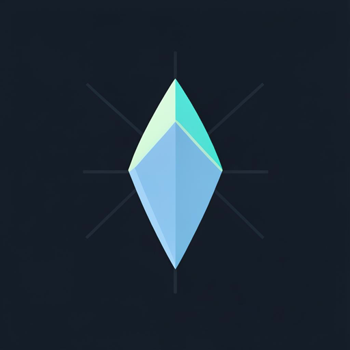

<p align="center">
  
</p>

<h1 align="center">Kyanite</h1>

<p align="center"><b>A GPU-driven object renderer for Geometry Dash.</b></p>

Kyanite replaces the renderer Geometry Dash uses for level objects. Group
transforms, triggers and visibility are resolved on the GPU every frame instead
of on the CPU, so levels that are CPU bound in vanilla keep their framerate.
Shaders, UI, particles and anything that isn't a level object are untouched.

A fork of [Bismuth](https://github.com/IliasHDZ/Bismuth) by IliasHDZ.

[Status](#status) · [Numbers](#numbers) · [How it works](#how-it-works) ·
[Settings](#settings) · [Compatibility](#compatibility) ·
[Building](#building) · [Credits](#credits) · [Discord](https://discord.gg/B6H6ZVJx9C)

## Status

Kyanite is alpha software. Levels built from group triggers render correctly.
Levels that use per-object effects still render, but the objects those effects
move stay where they started.

| Feature | Status |
|---|---|
| Rendering levels (GD 2.2081, Geode 5.11.2) | ✅ |
| Move, rotate, follow, toggle, alpha and pulse triggers | ✅ |
| Color channels, HSV, object pulse, blending modes | ✅ |
| Hitbox viewers (MegaHack, GD Mega Overlay, debug draw, hitboxes on death) | ✅ |
| Scale trigger (2067), area/enter effects (3006+), advanced follow, keyframes | ⚠️ levels render, affected objects don't animate |
| 2.2-only visuals (platformer camera and friends) | ❌ |
| Overdraw view, in-game toggle, difference mode | ✅ under *Debug tools* |
| Intel integrated GPUs | ⚠️ often slower than vanilla |

## Numbers

One test level, measured in game: 273,266 objects, 368,931 sprites, 943 group
combinations, 632 transform combinations, culled by 68 compute work groups.

| Build | FPS |
|---|---|
| Peaceful, before the culling fix | below 40 |
| Peaceful, current build | above 500 |

Every 5 seconds the mod logs where the frame went. One line looks like this:

```
Frame timing: 1042 FPS (0.96 ms/frame) | uniforms 3 us | color channels 4 us
 | group states 6 us (alpha 3, pulse 1, upload 2) | culling 11 us (sorted batch 0, 0 regen)
 | draw 48 us | other 888 us
```

`uniforms`, `color channels`, `group states`, `culling` and `draw` are Kyanite's
own cost. `other` is the rest of the frame: the game's update, UI and buffer
swap. If `other` is the only large number, nothing in Kyanite is holding you
back.

## How it works

| Piece | What it does | Where |
|---|---|---|
| Sprite meshes | Each sprite sheet and blend combination becomes one mesh; a level object's sprites are a range in its index buffer | `src/renderer/SpriteMeshDictionary.cpp` |
| Object buffers | Sprites are drawn instanced and fetch their object by id, so a frame no longer rebuilds per-object vertices | `src/renderer/Renderer.cpp` |
| Group state | Move, rotate, follow, toggle, alpha and pulse are kept per group combination and uploaded only when a value changes | `src/renderer/GroupManager.cpp` |
| Culling | A compute shader walks every sprite range, drops what is off screen and writes the draw order with a shared-memory prefix sum, 64 invocations per work group | `resources/shaders/objectCulling.comp` |
| Sorted batches | One index order per blend state (1085 states in GD). Rebuilt only when a state stays stable for a few frames, capped in the cache | `src/renderer/ObjectBatch.cpp`, `src/renderer/WorkGroupScheduler.cpp` |
| Hitboxes | Objects on screen are activated invisibly so the game computes their hitboxes normally | `src/renderer/hooks.cpp` |

The long version, with diagrams of how GD builds sprite batches and what the
culling pass does, is in [TechnicalExplanation.md](TechnicalExplanation.md).

## Settings

| Setting | Default | What it does |
|---|---|---|
| Kyanite enabled | on | Master switch. Off draws levels with GD's own renderer |
| Log frame timing | on | The 5 second frame breakdown above |
| GPU core count | `0` | Work groups used by the culling pass. `0` detects it; set it by hand if detection fails |
| Debug tools | off | F8 toggles the renderer, F9 difference mode, F7 selects objects right of the screen in the editor. Turns the optimizations off |
| Persistently mapped buffers | off | Buffer writes through a persistent mapping. Buggy on many drivers; sometimes helps on integrated GPUs |
| Disable object pulse | off | Stops objects pulsing to the song |

## Compatibility

### Hitboxes

Hitbox viewers draw the game's own hitbox rectangles. Kyanite keeps rendering
the level with its optimizations while they are open: objects on screen are
activated invisibly so the game can compute their hitboxes, and everything off
screen stays culled. Hitboxes line up with what you see, including objects
moved or rotated by triggers.

### Versions

The mod is built for **Geometry Dash 2.2081** with **Geode 5.11.2**. The source
is written to also build for **2.2091** with the **6.x SDK**: set `geode` to
`6.0.0-beta.1` and `gd.win` to `2.2091` in `mod.json`, then build with that SDK
and its bindings. The only version difference (`PlayLayer::init` arguments) is
behind a `GEODE_COMP_GD_VERSION` check. Geode rejects a `.geode` built for the
other version, so use the build that matches your loader.

### Triggers and effects

Group based triggers run on the GPU: move, rotate, follow, toggle, alpha and
pulse. Every other trigger keeps working, because it doesn't change how objects
are drawn.

Per-object effects are different. The Scale trigger, Area and Enter effects,
Advanced Follow and keyframes move or resize each object on its own, which a
per-group state can't describe. Levels that use them still render with the
speedup, but the objects those triggers touch keep their initial transform.
Giving those effects a per-object transform buffer is the next piece of work
(see [TODO.md](TODO.md)).

Objects from a sprite sheet the renderer has no mesh for are skipped; the rest
of the level renders normally.

## Building

Kyanite is built with the [Geode SDK](https://docs.geode-sdk.org/).

On Windows:

```
geode build
```

On Linux (cross-compiling for Windows):

```
geode sdk install-linux
geode build -p windows
```

If the SDK helper can't download the Windows SDK, the toolchain can be wired up
by hand:

1. `xwin --accept-license --arch x86_64 splat --output ./xwin-splat` (xwin 0.10+)
2. LLVM/clang 19 or newer, with `clang-cl`, `lld-link`, `llvm-lib`, `llvm-mt`,
   `llvm-rc` and `llvm-nm`
3. Configure:

```
cmake -S . -B build-win -G Ninja \
  -DGEODE_TARGET_PLATFORM=Win64 \
  -DCMAKE_TOOLCHAIN_FILE=<geode-sdk>/clang-cl-msvc.cmake \
  -DSPLAT_DIR=./xwin-splat -DHOST_ARCH=x86_64 \
  -DLLVM_VER=19 -DCLANG_VER=19 -DLLVM_PATH=<llvm>/bin \
  -DCMAKE_MSVC_RUNTIME_LIBRARY=MultiThreadedDLL
cmake --build build-win
```

Pushing to this repository also builds a Windows `.geode` through the GitHub
Actions workflow in `.github/workflows/multi-platform.yml`.

Nightly builds are posted in the Discord server: https://discord.gg/MDbQt3w8HC

## Credits

- [IliasHDZ](https://github.com/IliasHDZ): original author of Bismuth, which
  this fork is based on.
- Saryu: the original mod icon.
- [glm](https://github.com/g-truc/glm), [glslang](https://github.com/KhronosGroup/glslang)
  and [OpenCL-Headers](https://github.com/KhronosGroup/OpenCL-Headers): the
  libraries the renderer builds on.
- [Geode SDK](https://github.com/geode-sdk/geode): the mod loader.

## License

Kyanite - GPU-driven renderer for Geometry Dash
Copyright (C) 2026 IliasHDZ

If the program has been modified using AI, you CANNOT DISTRIBUTE a binary of
the modified program.

This project also CANNOT BE USED UNDER ANY CIRCUMSTANCES TO FACILITATE OR
ADVANCE GEOMETRY DASH LEVEL GENERATION OR MODIFICATION USING GENERATIVE AI.

Except for the above clauses, the GPL v3 license applies. See [LICENSE](LICENSE).
